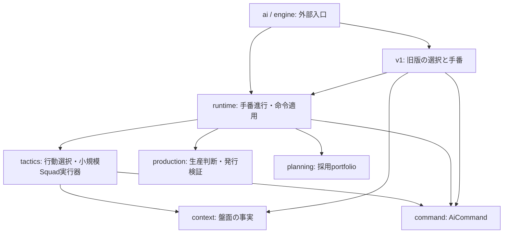

# AI再設計v3 段階1

`refactor/ai-redesign-v2` の提案書の段階1を実装する。段階2以降の編成・所属正本の変更や、
戦略を変えるS項目は含めない。受入検証の主比較はユーザー指定によりseed 1〜3へ短縮する。

## 依存と責務

変更前は `engine` が `runtime` / `tactics` を呼び、両者も命令型・戦術補助・状態のために
`engine` を参照していた。変更後の入口は `ai::execute_ai_turn`、命令型は `ai::AiCommand`。
互換用の `ai::engine` の再exportは外部APIだけとし、内部からは定義元を直接参照する。

`context/tactical.rs` はsnapshotと価値・占領可能物件・孤立判定を持つ。
`scoring` は優先度と待ち伏せ定数、`campaign` は所属に基づく戦術制約、`candidates` は
帰投燃料による候補制限、`relief` は生産口退避、`small_map/squad_executor` は小規模V4の実行順を持つ。
`runtime/issue` は命令をイベントへ適用し、`engine.rs` は版の選択だけを行う。

## 状態の持ち主と更新入口

| 状態 | 所有型・場所 | 更新入口 |
|---|---|---|
| 採用済みcampaign portfolio | `planning::decision::AdoptedTurnPortfolio` | `set_campaign_portfolio`。編成入口が採用結果を保存 |
| 手番の編成済み旗 | `runtime::state::AiTurnProgress` | `mark_squads_planned`。編成入口で一度記録 |
| 生産済み計画の旗・campaign発行列・汎用予算 | `production::turn_state::ProductionTurnState` | `set_campaign_production_plan_with_generic_budget`、`take_issuable_campaign_command`、`mark_production_batch_planned` |
| 行動選択の距離cache | `tactics::distance_cache::ActionDistanceCache` | `with_turn_distances` が貸出・返却。敵占有配置の変化時に破棄 |
| 発行待ちの汎用生産命令・施設cooldown | `runtime::production_queue` | `take_next_queued_production_command`、`issue_production_command`、手番進行 |
| 行動済みcooldown | `runtime::state::AiActionCooldown` | 手番進行・V1/V100の発行時 |

旧 `AiTurnStrategyCache` は廃止した。4つの一時Resourceは必要時に生成し、手番境界で削除する。各型は
別playerのデータを返さない。戦略の再選択やportfolioの更新時期は変えない。

## 生産と契約

- `AllocationState::try_claim` は `FacilityConflict` / `BudgetUnavailable` を返す。
  失敗時は残額・使用済み施設・施設ownerのすべてが不変。呼出側は失敗案を購入・配備へ渡さない。
- `validate_issue_for_turn` は計画手番、行動中player、Main、未終局に加えて従来の資金・施設条件を確認する。
  汎用とcampaignの両経路が共通検証と `IssueAudit` を使う。campaign列も計画手番を保持する。
  検証だけでは資金消費もspawnも行わず、命令適用後にもう一度実盤面で検証する。
  旧実装のログには、最後の撃破・占領による終局後にも続く生産試行が含まれていた。
  この購入案の出力は監査として消費することで履歴互換性を保ち、`GameOver` を監査へ記録する。
  V3では資金不足の購入試行も既存履歴に含まれる（map_6 seed1、T4、Rockets費6200・残額185）。
  最終発行入口は資金不足・施設喪失等も監査だけで1試行として返し、施設を試行済みにする。
  拒否を終了イベントなしの `None` として返すと手番が進まなくなるため、この契約を回帰テストで固定する。
  監査用の試行では生産イベントを発行しない。終局後は計画をIssuedへ進めない。
  購入案の選別（`next_issuable`）で拒否する案は従来どおり列から取り消す。
- `PlanContractRegistry` の書くだけのentity割当・binding台帳と、その生産イベント更新を削除した。
  契約IDは `PropertyContractId` とし、Roadmapの `StrategicOperationId` と型で区別する。発番値は維持する。
- 発行拒否時の永続工程・配備意図の解放、施設の同時確定、requested/effectiveの分離は段階3の対象。

## 検証

基準と候補を同じRust 1.99.0・release設定で作る。proposal記載のRust 1.97バイナリは再利用しない。
基準のgoldenは変更しない。判断fingerprintはV1〜V4各18条件
（map_1/6/25 × seed 1/2/3 × 両手番 × 30T）、主比較は
map_1/2/6/25/32 × seed 1/2/3 × 両手番 × 60T（30局）。

性能・複雑度の結果は以下に記録する。判断・全テストの最終結果も以下に記録する。

## 構造・複雑度の比較

テスト・コメントを除外する既存計測器を同じ定義で用いた。逆依存は参照のある行の数であり、
importする項目数ではない。

| 指標 | 変更前 | 変更後 |
|---|---:|---:|
| 禁止方向の参照行 | 7 | 0 |
| extendedへのglob再export | 9 | 8 |
| 経路判定 | 42 | 42 |
| 同名の通常/extended関数ペア | 37 | 37 |
| 修復処理呼出 | 16 | 16 |

RCA 0.0.25による複雑度（テスト除外）:

| 指標 | 変更前 | 変更後 |
|---|---:|---:|
| 名前付き関数 | 1059 | 1061 |
| 直接CC 合計 | 11235.0 | 11255.0 |
| 直接CC 最大 / p95 | 148.0 / 8.0 | 148.0 / 8.0 |
| 計画書定義CC 合計 | 7638.0 | 7649.0 |
| 計画書定義CC 最大 / p95 | 166.0 / 28.0 | 166.0 / 28.0 |
| 引数 >7 の関数 | 61 | 61 |
| 最大引数数 | 16.0 | 16.0 |
| 同一本文のグループ | 3 | 3 |

`plan_squads_with_hooks` の直接CCは148、V1の `decide_ai_action` は108のまま。
`decide_forming_campaign_site_relief`・小規模Squad executor・共通戦術の本文は置き場所を変えた。
大きな判断関数・修復周回の簡略化は段階2/3に残す。追加した検証分岐により全体のCC合計はわずかに増える。

引数は同じRCAのnargsから子spaceを差し引いた値。同一本文は名前付き関数の本文から
行コメントと空白を除いたもの（100文字以上）で比較した。3グループとも変更前からある
通常/extendedの重複で、新規の判断本文の重複は増えていない。測定JSONとソースhashは
`scratch/ai-redesign-v3-20261013/` に保存する（Git管理対象外）。

## 性能

map_6・seed1・V200先攻/V4後攻・60T上限（54Tで終局）。同じRust 1.99 release設定で、
基準2回（A/A）と候補1回を測定した。単一スレッドは `RAYON_NUM_THREADS=1` / jobs1、
既定並列はRayon既定 / jobs4（基準2局と候補1局を同じキューで実行）。
ほかのビルド・対局検証は止めた。各局は別プロセスで、4076判断step・296生産試行を観測した。
`OPENWARS_TRACE_AI_STEPS` の `elapsed_us` を集計するので、CPU占有時間ではなく判断の経過時間である。

A/Aの時間差を観測ノイズ幅とし、受入上限を「基準2回の平均＋2回の絶対差」と定義した。
平均step・p95・最悪step・生産判断の平均/p95は両条件ともこの上限以下。
行動履歴は3局とも完全一致。反復はノイズ/再現性の確認にだけ使い、勝率の独立標本に数えない。

| 条件 | 指標（ms） | 基準A | 基準A再測定 | 候補 |
|---|---|---:|---:|---:|
| 単一スレッド | 平均step | 23.060 | 20.658 | 21.798 |
| 単一スレッド | p95 step | 80.291 | 74.659 | 75.366 |
| 単一スレッド | 最悪step | 5959.432 | 4837.989 | 4955.898 |
| 単一スレッド | 平均生産判断 | 239.383 | 210.082 | 222.488 |
| 単一スレッド | p95 生産判断 | 1357.329 | 1238.908 | 1362.437 |
| 既定並列 | 平均step | 49.135 | 50.179 | 48.687 |
| 既定並列 | p95 step | 158.764 | 192.910 | 192.146 |
| 既定並列 | 最悪step | 15272.202 | 9115.685 | 12804.933 |
| 既定並列 | 平均生産判断 | 507.159 | 498.061 | 476.346 |
| 既定並列 | p95 生産判断 | 3106.328 | 2811.467 | 2544.973 |

他の検証と並走した予備測定では時間指標が揺れ、一部がA/A幅を超えた。
上表はその予備値を採用せず、負荷を止めて同条件で再測定した値である。
少数回・共有環境の測定なので高速化の主張には使わず、今回の非悪化確認に用いる。

## 最終チェック

- `cargo test --release --locked`: workspaceの全テスト成功。対局を含む同じ全件をreleaseで実行し、テスト数は短縮していない。
- コアのdebugテストも実行し、発行拒否・資金/施設の検証・手番境界の回帰テストは成功。
- `cargo fmt --all -- --check`: 成功。
- `cargo clippy --locked --all-targets --all-features -- -D warnings`: 成功。
- `cargo check --locked -p engine --target wasm32-unknown-unknown`: 成功。
- 計測器のPython単体テスト13件: 成功。
- `git diff --check`: 成功。goldenの内容は変更していない。

## 受入結果

- 判断fingerprint: V1〜V4各18条件、計72条件で全行動列hashと終局状態が基準に完全一致。
- 主比較: map_1/2/6/25/32 × seed 1/2/3 × 両手番 × 60T上限、30局。
  全局で **行動履歴の配列そのもの** と勝敗・ターン数が基準に完全一致（短縮hashだけの比較ではない）。
- workspace全テスト: 914成功、既存ignore 2件、失敗0。golden更新なし。
- 構造: 禁止方向参照7→0、旧 `AiTurnStrategyCache` なし。外部入口・命令型・命令適用・
  戦術の事実/比較/制約・4つの一時状態を定義元へ分離した。
- 性能: 上記の負荷を止めた単一スレッド/既定並列測定で、全指定指標がA/Aノイズ上限以下。

基準コミットは `f01f013`（proposal追記、実装コードは15c774cと同じ）。両側をRust 1.99.0で再ビルドし、
固定したバイナリを使用した。最終のソースhash・削除パス、バイナリsha256、72条件のfingerprint、
30局の完全照合結果、圧縮した全行動履歴、性能stepログ、複雑度JSON、テストログを
`scratch/ai-redesign-v3-20261013/` に保存した。ここはGit管理対象外。実装と検証記録は `refactor/ai-redesign-v3-stage1` ブランチにまとめる。

データの正本:

- `source-manifest.json` / `binaries.sha256` / `binaries/`
- `fingerprints.json` / `fingerprints/`
- `acceptance.json` / `baseline-action-histories.json.gz` / `final-action-histories.json.gz`
- `perf-single/metrics.json` / `perf-default/metrics.json`（元stepログも各ディレクトリに保持）
- `structure-before.json` / `structure-after.json` / `complexity-before.json` / `complexity-after.json`

この段階では、Roadmapの2回目の採用、固定点の削除、編成のpropose/commit、所属正本の一本化、
施設確定/要求量の分離、後攻小規模の戦略変更には着手していない。proposalの段階2以降で扱う。
